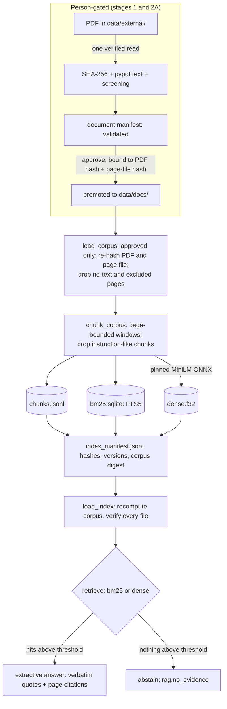

# Document retrieval (Milestone 05, stage 2C)

Status (2026-10-18): implemented on `feat/m05-stage2-secure-rag`. The **retrieval layer** works:
approved corpus, chunking, BM25 and dense indexes, retrieval with thresholds and abstention, and
an extractive cited answer. **Not yet done:** integration with `POST /api/v1/query`. The routing layer that decides when
documents may be used, including the edition guards, is implemented and evaluated
(docs/ROUTING.md) but not yet wired into the API. The stage 2E evaluation
(`eval/rag_metrics.py`) calibrated the thresholds and compared BM25, dense and deterministic-only
behaviour on a small labelled set; no general accuracy claim is made.

## Architecture



## Data flow

1. **Approved corpus** (`rag/corpus.py`). Only manifests with `status: approved` and an approval
   bound to the current PDF SHA-256 and page-file SHA-256 are admitted. Each time the corpus is
   loaded, the promoted PDF and the page file are re-read through verified handles and
   re-hashed; a mismatch raises `CorpusIntegrityError`. Pages without extractable text and the
   reviewer's `excluded_pages` are dropped here. Quarantined, planned, rejected or unbound
   documents are listed as skipped with a reason.
2. **Chunks** (`rag/chunk.py`, `chunk@v1`). Each page is chunked separately (a chunk never spans
   pages): 160-word windows overlapping by 40, pages under 12 words skipped. Chunks the
   screen flags as text addressed to an AI system are dropped. `chunk_id =
   <document>:p<page>:c<n>`; `text_sha256` is recorded.
3. **BM25** (`rag/index.py`). SQLite FTS5 with the `porter unicode61` tokenizer, built in
   memory, serialised to bytes and written through a verified handle.
4. **Dense** (`rag/embed.py`). `sentence-transformers/all-MiniLM-L6-v2` (Apache-2.0), ONNX,
   revision `1110a243fdf4706b3f48f1d95db1a4f5529b4d41`. Files are pinned by LFS SHA-256
   (`onnx/model.onnx` `6fd5d72f…`, `tokenizer.json` `be50c362…`) and read through verified
   handles. Mean pooling and L2 normalisation run on CPU (ONNX Runtime 1.31.0, one thread,
   sequential).
5. **Index manifest**. Records `index_id`, `ragindex@v1`, the corpus digest, each document's
   provenance and both hashes, exclusions, the chunker configuration, the screen version, the
   model (id, revision, file hashes, runtime version), counts, and the SHA-256 of every index
   file. `index_id` is derived from the corpus digest, chunker, screen version, index version
   and model, so any change of approved inputs or configuration is a different index.
6. **Load** (`load_index`). Recomputes the corpus from the approved manifests, derives the
   expected `index_id`, verifies every file hash and checks that the stored chunks equal the
   chunks of the current corpus. Missing → `IndexUnavailable`; mismatch → `IndexStale`.
7. **Retrieve** (`rag/retrieve.py`). BM25: the question becomes lower-case alphanumeric terms
   minus stop words, each quoted and joined with `OR`, so no FTS5 syntax from the question is
   interpreted. Reported score = `-bm25()`. Dense: cosine similarity. Exact duplicate chunks
   within one document are collapsed into one hit (`duplicate_pages`); identical text in two
   documents stays separate.
8. **Answer**. Verbatim excerpts from at most 3 hits, each cited with document, edition, page,
   chunk id, chunk hash, document and page-file hashes, source URLs and score. Hits from
   different editions are labelled and never merged. Caveats: "quoted document text, not a
   CivicMind calculation", plus each cited document's recorded limitations. Abstention codes:
   `rag.query_empty`, `rag.no_evidence`; index problems: `rag.index_unavailable`,
   `rag.index_stale`.

## Untrusted document text

Retrieved text is never given to a model and never interpreted; it is only quoted. Chunks the
screen flags (`docscreen@v2`: "ignore previous instructions", addresses to an AI or assistant,
role labels followed by a directive, chat role tags) are dropped from the index. Text the screen
misses can at most appear as an attributed quotation: it cannot change status codes, citations
or caveats (tested).

## Current index (built 2026-10-18)

| | |
|---|---|
| Documents | DOC-MORTH-RA2023 (256 pages indexed), DOC-MORTH-RA2019 (204 pages; pages 2-7 excluded) |
| Not indexed | DOC-MORTH-RA2024 (quarantined), DOC-SLB-HANDBOOK and DOC-MV-ACT (planned) |
| Chunks | 2,394, of which 1,646 are distinct texts (RA2019 repeats most pages, and the data-collection forms are identical in both editions) |
| Build time | about 7 minutes on CPU, almost all of it single-threaded embedding |

## Thresholds (calibrated in stage 2E)

`RetrievalConfig` defaults: `k = 5`, `bm25_min_score = 21.775342`, `dense_min_score = 0.638919`,
chosen on the 34-item calibration split of `eval/questions/rag.v1.yaml` (balanced accuracy). The
stage 2C provisional values (4.0 and 0.45) answered most questions that should be refused. See
[docs/evaluation/M05_RAG_EVALUATION.md](evaluation/M05_RAG_EVALUATION.md) for the results and the
failure modes: BM25 thresholds depend on query length, and dense similarity cannot detect a
missing edition. The thresholds are fitted to a small set and this index; recalibrate after any
re-chunking or re-indexing.

## Setup

```bash
.venv-py313/Scripts/python.exe -m pip install -e ".[api,dev,rag,rag-embed]" -c constraints-py313.txt
```

The model files are downloaded only with the owner's approval, into
`data/models/all-MiniLM-L6-v2/<revision>/` (git-ignored), and must match the pinned hashes.
Build or confirm the index:

```bash
.venv-py313/Scripts/python.exe scripts/build_doc_index.py
```

`--bm25-only` skips the vectors. Re-running on the same approved inputs confirms the existing
index; index files are never overwritten.

## Limitations

- Thresholds are calibrated on 34 items; BM25's depends on query length. Similarity is not
  evidence of correctness.
- Chunk boundaries ignore sentence and table structure; tables extract as runs of numbers.
- RA2024's annexure tables have no text layer and the document is quarantined; no 2024 document
  text is retrievable.
- Vectors are reproducible on one machine with the pinned runtime; bit-identical results across
  CPUs or library versions are not claimed, and a change would refuse the existing index folder
  rather than overwrite it.
- Index loading re-hashes the approved PDFs (about 3 s for the current corpus).
