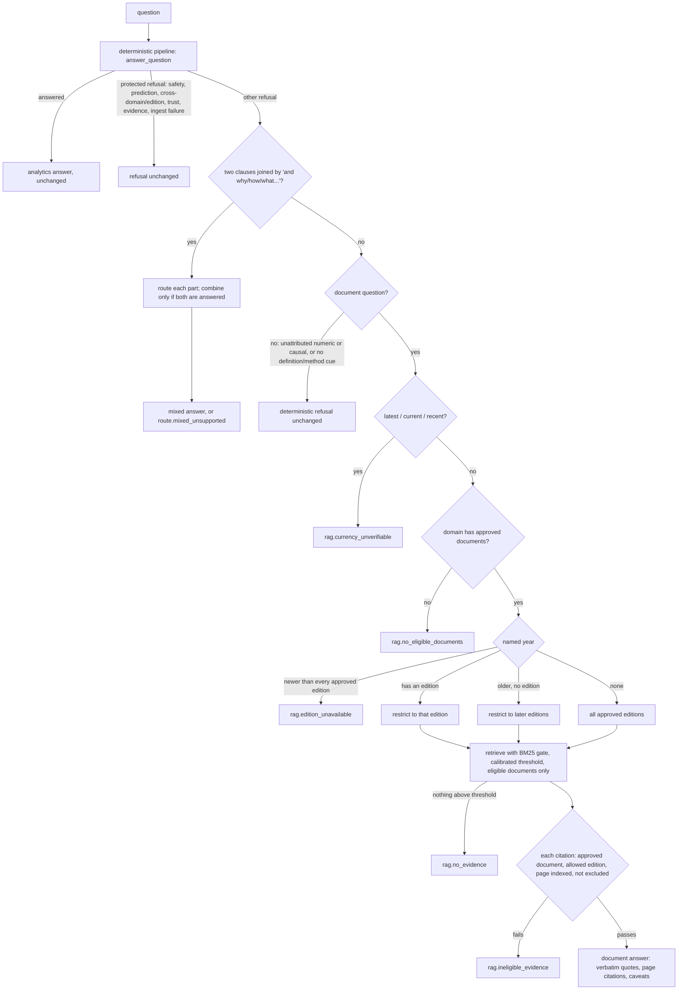

# Query routing and edition guards (Milestone 05, stage 2D)

Status (2026-10-18): `civicmind.orchestrator.router` is implemented, tested
(`tests/test_router.py`, 47 tests) and evaluated (`eval/route_metrics.py`). Since stage 2F it
serves `POST /api/v1/query` after the deterministic pipeline (BM25 gate only); see
[HTTP API (stage 2F)](#http-api-stage-2f). Deterministic responses are unchanged.

## Flow

## Rules

- **Deterministic first.** The existing pipeline always runs first; its answers are returned
  unchanged, and so are its refusals unless the question qualifies as a document question.
- **Protected refusals are never overridden by documents**: `query.empty`, `query.too_long`,
  `query.prompt_injection`, `query.predictive`, `query.cross_domain`, `query.cross_edition`,
  `query.unit_unsupported`, `period.unavailable`, every trust-state code (`status.quarantined`,
  `status.rejected`, `status.not_trusted`, `dataset.not_trusted`, `modelled.not_trusted`,
  `exploratory.not_permitted`), `evidence.invalid`, `pipeline.internal_error`,
  `pipeline.step_limit`, and every ingest failure of server-side data
  (`INGEST_FAILURE_CODES`: `integrity.hash_mismatch`, `integrity.size_mismatch`,
  `integrity.not_recorded`, `file.missing`, `file.not_csv`, `path.unsafe`, `csv.decode_error`,
  `csv.empty`, `csv.malformed`, `csv.ragged_rows`, `schema.duplicate_columns`,
  `schema.family_mismatch`, `schema.manifest_mismatch`, `schema.unknown`, `validation.errors`,
  `validation.unaccepted_warnings`, `review.stale`). The ingest list is explicit, not an
  `ingest.*` wildcard; `tests/test_router.py` checks it against every refusal code
  `catalog/ingest.py` raises, so a new ingest code must be classified. A document answer must
  never stand in for damaged data: it would hide the failure. Example: S30 asks for a census
  figure "according to the report"; the census dataset is quarantined, so the refusal stands.
- **Document questions**, from closed patterns with no model: definition or methodology cues
  ("define", "what is a", "what counts as", "formats", "project", "scheme", "meant to", …) or
  explicit attribution ("according to the report", "the 2019 report", "the ministry", "MoRTH",
  "Transport Research Wing"). **Numeric** ("how many", "what share", "top 3", …) and **causal**
  ("why", "due to", …) questions use documents only with explicit attribution; otherwise the
  deterministic refusal stands. Documents are never a numeric fallback.
- **Currency**: "latest", "current", "currently", "newest", "most recent", "recent",
  "up-to-date", "this year", "now", "today" and "so far" refuse with `rag.currency_unverifiable`.
  The newest approved edition is never assumed to be current.
- **Editions**: a named year with an approved edition restricts retrieval to that edition. A
  year newer than every approved edition refuses with `rag.edition_unavailable`: a 2024 question
  is never answered from RA2023 or RA2019. An older year without its own edition may use only
  later editions, which report earlier years. RA2024 is quarantined and not in the corpus at all.
- **Domains**: only `roads` has approved documents; water, waste and census document questions
  refuse with `rag.no_eligible_documents`.
- **Eligibility re-check** on every citation (defence in depth on top of the corpus loader): the
  document is in the approved, hash-verified corpus, its edition is allowed, and the page is
  indexed, not excluded and not textless. Any violation fails closed with
  `rag.ineligible_evidence`. RA2019 pages 2-7 are excluded at corpus level and re-checked here.
- **Mixed questions**: split on ", and why/how/what/…". Each part is routed independently, and a
  year named anywhere applies to both. The answer is combined only if both parts are answered;
  otherwise `route.mixed_unsupported` lists each part's code, and no partial answer is returned.
- **Index state**: the router loads and verifies the index once (`Router.reload()` re-verifies).
  Missing, stale or tampered inputs refuse with `rag.index_unavailable`, `rag.index_stale` or
  `rag.corpus_integrity`.
- **Gate**: `RouterConfig.gate = "bm25"` (chosen on the calibration split, see below) at the
  stage 2E calibrated threshold. `dense` is available for comparison. The stage 2C provisional
  thresholds are kept only as a comparison row in the evaluation.

## Stable refusal codes added by the router

`route.mixed_unsupported`, `rag.currency_unverifiable`, `rag.edition_unavailable`,
`rag.no_eligible_documents`, `rag.ineligible_evidence`, `rag.corpus_integrity`, plus the
retrieval codes `rag.query_empty`, `rag.no_evidence`, `rag.index_unavailable` and
`rag.index_stale`. Every refusal has a code, a reason, no citations and no value.

## Evaluation

See [docs/evaluation/M05_ROUTING_EVALUATION.md](evaluation/M05_ROUTING_EVALUATION.md).

## HTTP API (stage 2F)

`civicmind.api.retrieval.DocumentRetrieval` puts the router behind `POST /api/v1/query`
without changing the deterministic path. Router logic, thresholds and gate are unchanged
(BM25, calibrated stage 2E threshold); the API refuses to start with any other gate.

**Order.** The route handler runs the deterministic pipeline exactly as before. If it answers,
the router is not consulted. If it refuses with a **server-side failure** (any refusal the API's
`status_for` maps to HTTP 5xx: damaged or invalid dataset files, a failed evidence check, an
internal error), the router is not consulted either and the deterministic response and status
stand unchanged (no `route`, no citations); this uses the same status mapping as the response,
and the router's own protected codes are a second, independent layer. Otherwise the router is
given that same answer (it does not re-run the pipeline on the whole question) and decides. In
a mixed question, a part that hits a server-side failure is refused with its own code, the
whole is `route.mixed_unsupported`, and the response takes that part's 5xx status. When the router's outcome is the
deterministic one (protected refusal, or not a document question), the response is byte for
byte the deterministic API's: the new fields are absent.

**Response fields (additive, present only when the router went past the pipeline):**

- `route`: `{kind: documents | mixed | refused, code, reason, gate: "bm25", index_id,
  editions, parts, trace}`. `code` is the router's outcome (`rag.*`, `route.*`), null when
  answered. `parts` lists each clause of a mixed question with its own `result`, `evidence`
  and `citations`.
- `citations`: verbatim passages with `document_id`, `title`, `edition`, `page` (1-based PDF
  page), `chunk_id`, `chunk_sha256`, `document_sha256`, `extraction_sha256`, `source_class`,
  `publication_date` (null when unverified), `resource_page`, `download_url`, BM25 `score` and
  `quote`.
- A document answer has `result: null` and `evidence: []`: quoted text is never a CivicMind
  value. Its first caveat says so; the documents' own limitations (mirror provenance,
  unverified date and licence) follow.

**Refusal codes are stable.** A refusal keeps the deterministic `refusal.code`, `stage` and
`reason`; the router's code is only in `route.code`. On `coverage.v1`, 5 of 35 items are
document-eligible refusals that now carry a `route` block; their `refusal.code` and HTTP status
are unchanged (see `eval/reports/api.v1.results.md`).

**HTTP status.** Answers are 200. A routed refusal has the deterministic status, raised to
503 when the router reports `rag.index_stale` or `rag.corpus_integrity` (server-side document
data failed a check), and 500 with `route.code = pipeline.internal_error` if routing raised
on a refused question (exception text is logged, never returned). If routing raised on a
question the pipeline answered (it is not consulted for those), the validated deterministic
answer is returned unchanged with its 200. `rag.index_unavailable` (no index built) is 200.
Deterministic 503/500 refusals keep their status and are never routed (see **Order**).

**Index integrity.**

- *Startup*: `create_app` builds one `Router`, which loads and fully verifies the index for the
  current approved corpus: document approvals, PDF and page-file SHA-256, recomputed chunks
  (page exclusions applied), every index file's SHA-256, and the model specification (MiniLM
  revision and file hashes are part of the index id). About 3 s locally. An unreadable index
  or manifest is treated as `rag.index_stale`. Nothing is downloaded or built at runtime;
  build with `scripts/build_doc_index.py`.
- *Before use*: before document evidence is returned, the approved corpus is re-derived from
  the document manifests (`civicmind.rag.corpus.approved_digest`, metadata only, ~0.1 s) and
  must equal the loaded index's corpus. A document withdrawn, quarantined or re-reviewed after
  startup withholds the answer (`rag.index_stale`, 503) and leaves retrieval unavailable until
  the process restarts. Bytes are not re-hashed per request; changed files are detected at
  the next startup.
- *Readiness*: `GET /api/v1/ready` adds `retrieval: {status: ready | unavailable | disabled,
  code, gate, index_id, documents, chunks}`. It never changes the readiness `status` or HTTP
  code, which describe the structured-data catalogue.

**Concurrency.** The loaded index is read-only, but its in-memory BM25 index is a single
SQLite connection shared by FastAPI's worker threads. Routing is always serialised with a lock
(independent of the SQLite build's thread-safety mode). Deterministic answers never take it;
document-eligible questions wait for each other (~10 ms each; a mixed question also runs the
pipeline per part under the lock). A throughput limit, acceptable for a local development API.

**No `assert` on the answer path.** The check that every quote is verbatim chunk text raises
an error (HTTP 500, no answer) instead of using `assert`, so it also holds under `python -O`.

**Known limitations (stage 2F).**

- Coverage is low by design of the BM25 gate: 7 of 38 supported items answered with a gold
  citation (3 of 19 held out). Most document questions are refused.
- Eligibility patterns are closed and literal: "what is the …" counts as a definition cue, so
  a numeric question such as "What is the over-speeding accident growth rate … from 2019 to
  2024?" reaches the document guards (here it is refused by the edition guard). Not changed in
  stage 2F, because that would alter the frozen stage 2D results.
- Report-attributed numeric questions (e.g. "How many black spots did the ministry identify
  for 2018?") can be answered as quoted passages, never as a `result` value.
- Fixed in stage 2F: retrieval used to search one approved document per edition (a
  per-edition mapping kept the last one), so a second approved document of the same edition
  would have been silently ignored. Every approved document of an allowed edition is now
  searched. The current corpus has one document per edition, so the frozen stage 2D results
  are unaffected (re-run and compared). Documents without an edition are never eligible.
- No composite item in the frozen set was answered; the mixed path is covered by synthetic
  tests only.
